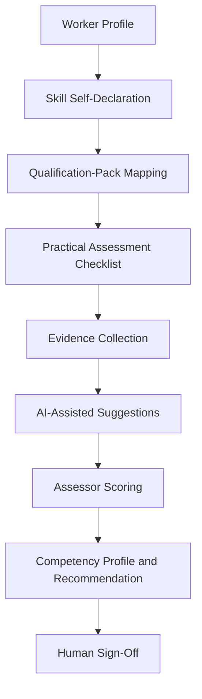
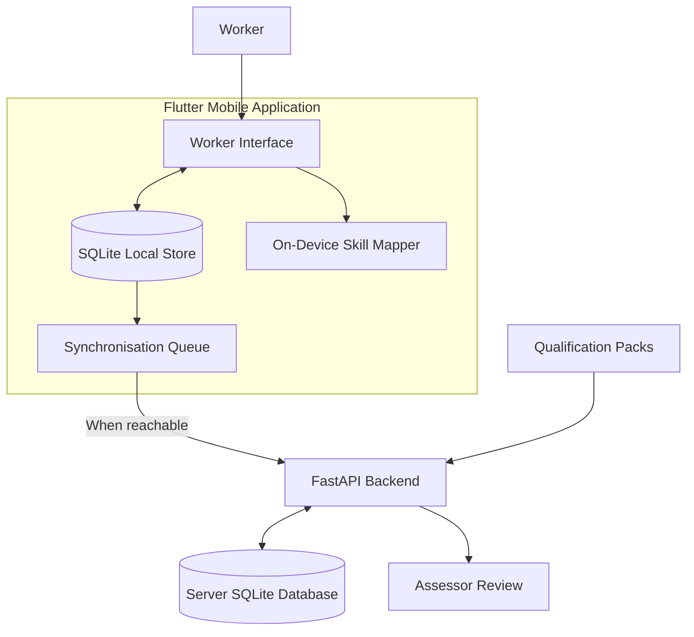
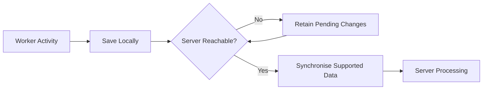

# KaushalSetu
### AI-Assisted Recognition of Prior Learning

**SIH26242 | Mobile-Based Skill Assessment Platform**

KaushalSetu is a Flutter application with a FastAPI backend designed to support Recognition of Prior Learning (RPL). It helps workers document skills gained through practical experience, map their declarations against configured qualification data, and participate in a structured assessment process with human assessor oversight.

[](https://flutter.dev/)
[](https://fastapi.tiangolo.com/)
[](https://www.python.org/)
[](https://developer.android.com/)

---

## Overview

Workers often acquire valuable occupational skills outside formal education. Documenting those skills and connecting them to recognised qualification requirements can be difficult, particularly when digital access and connectivity are limited.

KaushalSetu aims to make this process more accessible through a mobile-first workflow that combines worker self-declaration, qualification-pack mapping, structured practical tasks, assessment evidence, and assessor review.

The application is designed around three principles:

- **Accessibility:** a guided mobile experience for workers with different levels of digital familiarity.
- **Offline support:** local storage and on-device mapping for supported worker activities.
- **Human oversight:** automated suggestions support the process; assessment decisions remain with the authorised assessor.

## How It Works



The workflow is intended to help organise assessment information. A suggested match or automated observation is not, by itself, proof of competency or an official qualification.

## Features

| Feature | Description |
|---|---|
| Worker self-declaration | Records existing skills and work experience. |
| Qualification mapping | Matches declarations against configured qualification-pack data using an on-device mapping engine. |
| Practical checklist | Provides structured tasks to support the assessment process. |
| Evidence collection | Supports the evidence workflow, including photo or video evidence where implemented and available. |
| AI-assisted suggestions | Can provide advisory observations or explanations when the relevant backend integration is configured. |
| Assessor scoring | Supports structured assessment using a 0–3 anchored rubric. |
| Competency profile | Organises assessment findings and recommendations. |
| Offline-first worker workflow | Saves supported data locally and allows later synchronisation. |
| Assessor workflow | Provides server-backed access to assessment review functions. |

Feature availability may depend on the app build, backend configuration, permissions, and available qualification data.

## Application Preview

KaushalSetu is designed for workers whose skills are built through hands-on experience. The illustration below reflects the communities and traditional trades the application aims to support.

<p align="center">
  
</p>

The application supports skill declarations, qualification-pack mapping, structured assessment tasks, evidence review, and assessor-led decisions.

Trade illustrations and interface assets are maintained in `mobile/assets/images/`. Screenshots of the running application will be added as the final build is validated.

## System Architecture



### Technology Stack

| Component | Technology |
|---|---|
| Mobile application | Flutter, Dart |
| State management | Provider |
| Local database | SQLite via `sqflite` |
| Local preferences | Shared Preferences |
| Backend API | FastAPI, Python |
| Server database | SQLite |
| Data exchange | HTTP and JSON |
| Qualification data | JSON qualification packs |
| Tests | Flutter test framework and Python test tooling |

## Repository Structure

```text
KushalSetu/
├── app/                         # Supporting application components
├── docs/
│   ├── architecture and design documentation
│   └── evaluation notes
├── mobile/
│   ├── android/                 # Android project configuration
│   ├── assets/
│   │   ├── data/                # Bundled qualification catalogue
│   │   └── images/              # Illustrations and trade artwork
│   ├── lib/
│   │   ├── screens/             # Worker and assessor interfaces
│   │   ├── services/            # API, database, mapping and sync
│   │   ├── state/               # Application state
│   │   ├── theme/               # Visual theme
│   │   └── widgets/             # Reusable interface components
│   └── test/                    # Flutter tests
└── server/
    ├── app/                     # FastAPI application
    ├── data/
    │   └── qualification_packs/ # Qualification-pack JSON files
    └── tests/                   # Backend tests, if present
```

## Getting Started

### Prerequisites

- Git
- Flutter SDK and Dart
- Android Studio and Android SDK, or a compatible Android device
- Python and pip, using a version compatible with the backend dependencies

### 1. Clone the repository

```bash
git clone https://github.com/JX-Nexus/KushalSetu.git
cd KushalSetu
```

### 2. Set up the backend

Run the following commands in PowerShell:

```powershell
cd server

python -m venv .venv
.\.venv\Scripts\Activate.ps1

python -m pip install -r requirements.txt
```

Configure assessor credentials before starting the service:

```powershell
$env:KS_ASSESSORS = "assessor1:ChangeMe123:Asha Verma,assessor2:ChangeMe456:Ravi Patil"
```

Replace these example credentials with your own secure credentials. Do not commit real passwords or API keys to the repository.

Start the backend:

```powershell
uvicorn app.main:app --host 0.0.0.0 --port 8000
```

When the server is running, its endpoints can be checked at:

- Health endpoint: `http://localhost:8000/api/health`
- Interactive API documentation: `http://localhost:8000/docs`

If the development-only default assessor accounts are enabled by the backend when `KS_ASSESSORS` is unset, use them only in a local development environment. Check the server configuration and logs to confirm the behaviour of your current version.

### 3. Run the mobile application

Open a second PowerShell terminal:

```powershell
cd mobile

flutter pub get
flutter devices
flutter run
```

If multiple devices are connected, specify the target device:

```powershell
flutter run -d <device-id>
```

#### Connecting the mobile app to the backend

- **Android emulator:** use `http://10.0.2.2:8000` to reach the host computer's local backend.
- **Physical Android device:** configure the server address using the app's settings, if available. Use the computer's local network IP address, keep both devices on the same network, and allow the required port through the firewall.

The worker workflow supports selected activities without a running backend, using locally stored data and on-device mapping. Server-dependent functions, including assessor sign-in, require the backend to be reachable.

### 4. Run tests

For the mobile application:

```powershell
cd mobile
flutter test
flutter analyze
```

For the backend, from the `server` directory:

```powershell
python -m pytest tests -q
```

Run these checks after making changes. Static analysis may report informational lint suggestions that do not prevent compilation.

## Working with Qualification Data

Qualification-pack data is stored in JSON files under:

`server/data/qualification_packs/`

To introduce or modify qualification data:

1. Review the existing JSON schema and sample packs.
2. Update or add the relevant qualification-pack data.
3. Validate the data against the application's expectations.
4. Test the mapping results against representative worker declarations.
5. Ensure the bundled catalogue is updated when required for first-launch offline use.

The project includes data import and evaluation scripts where provided. Check the available scripts and their usage instructions before running them.

Mapping quality depends on the accuracy of the source data, declaration quality, and the matching logic. New qualification packs should be validated before they are used in an assessment workflow.

## Offline Support and Synchronisation

The mobile application uses local storage to support selected worker activities when connectivity is unavailable.



Offline support is limited to functionality implemented locally. Remote authentication, server-side review, and other backend-dependent operations may require connectivity. Synchronisation behaviour should be tested when changing the local data model or API.

## AI Assistance and Human Oversight

AI-assisted functionality, when configured, is intended to provide suggestions that can help organise or interpret assessment information. It should not replace the assessor's judgement.

- Automated matching is a suggestion, not a certification decision.
- Evidence and automated observations require appropriate interpretation.
- Assessment scoring and final sign-off remain subject to human review.
- Any optional language-model integration requires its corresponding configuration and credentials.

## Evaluation and Limitations

Refer to `docs/evaluation.md` for the project's evaluation notes, where available.

**Qualification data notice:** the included qualification packs are demonstration data and should not be presented as official NCVET qualification documents unless their provenance and validity have been independently confirmed.

KaushalSetu is a supporting assessment application. It does not itself issue an official NSQF qualification or NCVET certificate.

## Visual Assets and Licences

App illustrations and trade artwork are stored in `mobile/assets/images/`. The asset licence and attribution information is documented in `mobile/assets/LICENSES.md`.

When replacing an illustration, retain the expected filename or update the corresponding asset reference in the code. Ensure that new artwork has an appropriate licence and that its source is recorded.

## Contributing

Contributions and technical feedback are welcome.

1. Fork the repository.
2. Create a branch for your change.
3. Make the change and add or update tests where appropriate.
4. Run the relevant checks.
5. Submit a pull request with a concise description of the changes.

## Project Information

**Project:** KaushalSetu  
**Problem ID:** SIH26242  
**Repository:** [JX-Nexus/KushalSetu](https://github.com/JX-Nexus/KushalSetu)

---

*KaushalSetu — connecting practical experience with structured skill recognition.*
